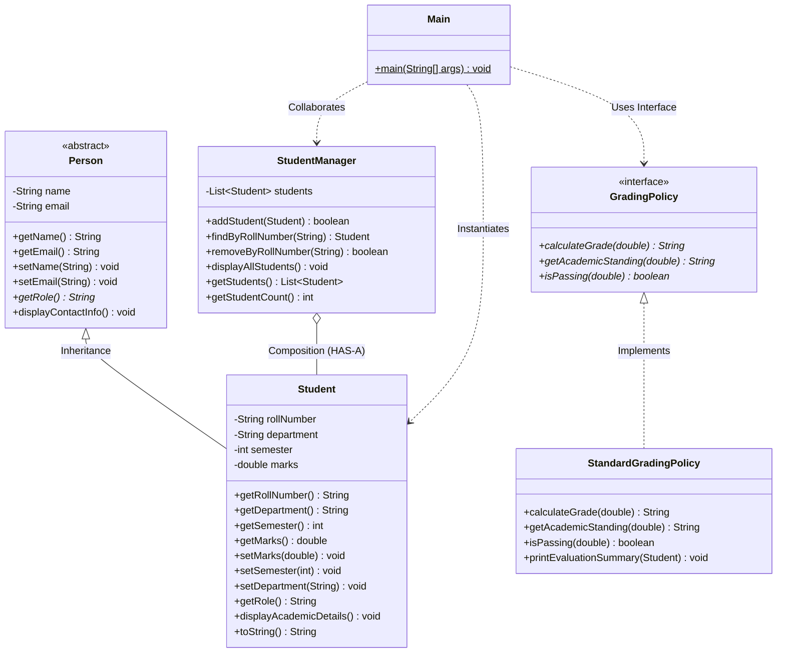

# StudentHub — Object-Oriented Programming (OOP) Documentation

> [!NOTE]
> **Implementation Status: Completed & Verified (Stage 6)**
> The standalone Java OOP demonstration module is implemented in the [`java-oop-demo/`](../java-oop-demo/) directory. It compiles with JDK 21 (`javac 21.0.12.1`) and executes independently of the Flask backend and MySQL database, providing demonstrable evidence of university Object-Oriented Programming curriculum competencies.

---

## 1. Introduction and Academic Context

StudentHub was developed as a college mini project. To satisfy both modern web application requirements (using Python Flask and MySQL) and academic computer science curriculum requirements (core Object-Oriented Programming principles in Java), the project includes this standalone Java demonstration module.

The Java module operates as an independent console package demonstrating how the core StudentHub domain entities (`Person`, `Student`, `GradingPolicy`, `StandardGradingPolicy`, `StudentManager`) map to fundamental OOP concepts in standard Java.

---

## 2. Core OOP Concepts Explained & Code Mapping

Object-Oriented Programming (OOP) is a programming paradigm based on the concept of "objects", which contain data (attributes/fields) and code (methods/behaviors).

### A. Classes and Objects

* **Concept**:
  * A **Class** is a blueprint, prototype, or user-defined type from which individual objects are created. It defines the state and behavior common to all objects of that type.
  * An **Object** is a specific, concrete instance of a class that holds actual values in memory.
* **StudentHub Implementation**:
  * *Class*: [`Student.java`](../java-oop-demo/src/Student.java) defines attributes such as `rollNumber`, `department`, `semester`, and `marks`, while inheriting `name` and `email` from `Person`.
  * *Object*: Instantiated in [`Main.java`](../java-oop-demo/src/Main.java#L27-L31):
    ```java
    Student student1 = new Student("CS-2026-001", "Aarav Sharma", "aarav.sharma@college.edu", "Computer Science", 4, 91.50);
    ```

### B. Encapsulation

* **Concept**:
  * Encapsulation is the mechanism of wrapping data (variables) and code (methods) together as a single unit, while restricting direct access to internal object components (data hiding).
  * This is achieved using access modifiers (`private`) and providing controlled access via public getters and defensive setters with validation checks.
* **StudentHub Implementation**:
  * In [`Student.java`](../java-oop-demo/src/Student.java#L13-L17), fields `rollNumber`, `department`, `semester`, and `marks` are declared `private`.
  * Controlled mutators enforce invariants and prevent illegal states:
    ```java
    public void setMarks(double marks) {
        if (marks < 0.0 || marks > 100.0) {
            throw new IllegalArgumentException(
                String.format("Invalid marks: %.2f. Marks must be between 0.00 and 100.00.", marks)
            );
        }
        this.marks = marks;
    }
    ```
  * In `Main.java`, attempting to assign `115.00` marks or semester `9` is caught and handled via `try-catch` blocks, demonstrating robust state protection.

### C. Inheritance

* **Concept**:
  * Inheritance is the mechanism by which one class acquires the properties and methods of another class, promoting code reusability and establishing an "IS-A" hierarchical relationship.
  * The class inherited from is the *superclass* (base/parent class), and the class that inherits is the *subclass* (derived/child class).
* **StudentHub Implementation**:
  * Superclass: [`Person.java`](../java-oop-demo/src/Person.java) encapsulates shared identity attributes (`name`, `email`) and common behaviors (`displayContactInfo()`).
  * Subclass: [`Student.java`](../java-oop-demo/src/Student.java) extends `Person`:
    ```java
    public class Student extends Person {
        public Student(String rollNumber, String name, String email, String department, int semester, double marks) {
            super(name, email); // Invokes Person constructor
            ...
        }
    }
    ```
  * The student object inherits `getName()` and `getEmail()` directly without code duplication.

### D. Abstraction

* **Concept**:
  * Abstraction is the quality of dealing with ideas rather than specific events, hiding internal implementation details and exposing only essential functional interfaces to the user.
  * In Java, abstraction is achieved using **Abstract Classes** (`abstract class`) and **Interfaces** (`interface`).
* **StudentHub Implementation**:
  1. **Abstract Class**: `Person` cannot be instantiated directly with `new Person(...)` because a generic "person" does not exist in an academic roster without a specific role.
  2. **Interface**: [`GradingPolicy.java`](../java-oop-demo/src/GradingPolicy.java) defines the academic evaluation contract:
     ```java
     public interface GradingPolicy {
         String calculateGrade(double marks);
         String getAcademicStanding(double marks);
         boolean isPassing(double marks);
     }
     ```
  * The concrete evaluation rules are encapsulated in [`StandardGradingPolicy.java`](../java-oop-demo/src/StandardGradingPolicy.java), cleanly separating the contract from the algorithm.

### E. Polymorphism

* **Concept**:
  * Polymorphism ("many forms") allows entities to be treated in different ways depending on context.
  * **Runtime Polymorphism (Dynamic Method Dispatch)** occurs when an overridden method is invoked through a superclass or interface reference, resolving to the child class implementation at runtime.
* **StudentHub Implementation**:
  1. **Parent-Class Reference**:
     ```java
     Person personReference = student1; // Student assigned to Person reference
     System.out.println(personReference.getRole()); // Dispatches dynamically to Student.getRole() -> "Student"
     ```
  2. **Interface Reference**:
     ```java
     GradingPolicy policy = new StandardGradingPolicy();
     String grade = policy.calculateGrade(84.50); // Calls StandardGradingPolicy implementation -> "A+"
     ```

### F. Composition and Collections

* **Concept**:
  * Composition models a "HAS-A" relationship where a complex object is composed of one or more other objects.
* **StudentHub Implementation**:
  * [`StudentManager.java`](../java-oop-demo/src/StudentManager.java) "HAS-A" collection of `Student` objects:
    ```java
    public class StudentManager {
        private final List<Student> students = new ArrayList<>();
        ...
    }
    ```
  * It coordinates operations across the collection:
    - Adding students and rejecting duplicate roll numbers.
    - Searching by roll number (`findByRollNumber`).
    - Removing records (`removeByRollNumber`).
    - Displaying all students in a formatted tabular view.

---

## 3. Class Architecture Diagram



---

## 4. Relationship Between Java OOP Module and the Full-Stack Web App

| Attribute | Web Application (Stages 1–5) | Academic Java Module (Stage 6) |
| :--- | :--- | :--- |
| **Primary Goal** | Real-world interactive student management system | Demonstration of university OOP curriculum competencies |
| **Language & Runtime** | Python 3.9 (Flask), TypeScript/React (Vite) | Java 21 LTS (Amazon Corretto) |
| **Execution Context** | Browser GUI + HTTP REST Server + MySQL Daemon | Terminal / Console CLI |
| **Data Persistence** | Relational tables in MySQL Server (`students`) | In-memory `ArrayList<Student>` collection |
| **Validation Layer** | Pydantic / SQLAlchemy validators + HTTP JSON codes | Defensive setter bounds checking (`IllegalArgumentException`) |
| **External Dependencies** | Node modules, Flask, PyMySQL, SQLAlchemy | Zero external dependencies (Standard Java SE standard library) |

---

## 5. Compilation and Execution Instructions

The module compiles and runs cleanly using standard JDK tools:

### Prerequisites
- JDK 17 or 21 (`javac -version`)

### Compilation
```bash
# From workspace root
mkdir -p java-oop-demo/bin
javac -d java-oop-demo/bin java-oop-demo/src/*.java
```

### Execution
```bash
# Run Main class
java -cp java-oop-demo/bin Main
```

---

## 6. Verification and Audit Statement

* **Inspected Date**: October 2026
* **JDK Version**: OpenJDK 21.0.12.1 LTS (Amazon Corretto 21)
* **Classes Implemented**: 6 (`Person`, `Student`, `GradingPolicy`, `StandardGradingPolicy`, `StudentManager`, `Main`)
* **Verification Status**:
  - Compilation: **PASS** (`javac -d java-oop-demo/bin java-oop-demo/src/*.java` with 0 errors)
  - Execution: **PASS** (`java -cp java-oop-demo/bin Main` with 10/10 steps verified)
  - Duplicate Rejection: **PASS** (`CS-2026-001` imposter rejected)
  - Defensive Validation: **PASS** (Marks `115.00` and Semester `9` rejected with exception)
  - Polymorphism: **PASS** (`Person` dynamic dispatch and `GradingPolicy` interface dispatch verified)
